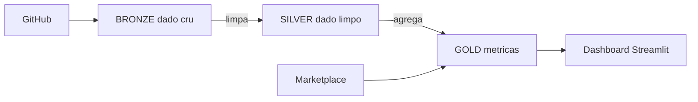

# HOL ESPM - Do dado bruto à decisão

Hands-on Lab de **pipeline de dados para Martech** com Snowflake e Cortex Code.

Cenário: a **Loja Paulista**, varejista de moda e casa com lojas físicas, site e app. Os dados de clientes, pedidos e campanhas estão espalhados e "sujos". Vamos transformá-los em indicadores de negócio.



## Antes da aula

1. Crie sua conta trial gratuita: `{{LINK_SIGNUP}}`
2. Escolha **Enterprise**, nuvem **AWS** e região **US West (Oregon)**.

## Passo a passo do setup (15 min)

| # | O que fazer | Onde |
|---|---|---|
| 1 | Copie o conteúdo de [`setup/00_setup_git.sql`](setup/00_setup_git.sql) e rode tudo | Snowsight > Projects > Workspaces > + SQL File |
| 2 | Copie e rode [`setup/01_setup_compute_pool.sql`](setup/01_setup_compute_pool.sql) | mesmo lugar |
| 3 | Crie um Workspace a partir deste repositório (URL deste repo, integração `GIT_ESPM_INT`, *Public repository*) | Projects > Workspaces > From Git repository |
| 4 | Abra `notebooks/01_bronze_ingestao.ipynb` e conecte ao pool `ESPM_NOTEBOOK_POOL` (idle timeout 4h) | Workspace |

## Roteiro da aula

| Notebook | Tema | Conceitos |
|---|---|---|
| `01_bronze_ingestao` | Trazer os dados | stage, COPY INTO, SQL básico |
| `02_silver_dynamic_tables` | Limpar | Dynamic Tables, deduplicação, padronização |
| `03_gold_streams_tasks` | Gerar métricas e automatizar | Gold, Streams, Tasks, carga incremental |
| `04_snowpark` | Python no Snowflake | Snowpark DataFrame, UDF |
| `05_git_dbt` | Código versionado | Git, dbt Projects on Snowflake |
| `06_consumo_streamlit_marketplace` | Consumir e enriquecer | Streamlit, Marketplace |

Procure as células marcadas com `EXERCICIO`: complete os `???` com o que aprender na aula. Se travar, use o prompt sugerido no **Cortex Code** (ícone no canto inferior direito do Snowsight).

## Estrutura

```
setup/        scripts iniciais (rodar uma vez)
notebooks/    notebooks da aula
data/         CSVs da Loja Paulista (bronze)
incremental/  pedidos que "chegam" durante a aula
dbt_project/  projeto dbt do notebook 05
streamlit/    app do notebook 06
```

## Depois da aula

Para não consumir créditos da trial:

```sql
USE ROLE ACCOUNTADMIN;
ALTER COMPUTE POOL ESPM_NOTEBOOK_POOL SUSPEND;
ALTER WAREHOUSE ESPM_WH SUSPEND;
```
