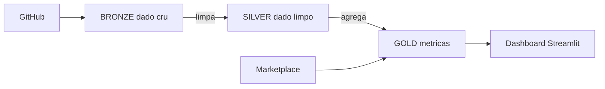

# HOL ESPM - Do dado bruto à decisão

Hands-on Lab de **pipeline de dados para Martech** com Snowflake e Cortex Code.

Cenário: a **Loja Paulista**, varejista de moda e casa com lojas físicas, site e app. Os dados de clientes, pedidos e campanhas estão espalhados e "sujos". Vamos transformá-los em indicadores de negócio.



## Antes da aula

1. Crie sua conta trial gratuita: `{{LINK_SIGNUP}}`
2. Escolha **Enterprise**, nuvem **AWS** e região **US West (Oregon)**.

## Passo a passo do setup (15 min)

| # | O que fazer | Onde |
|---|---|---|
| 1 | Copie o conteúdo de [`01_setup/01_setup_git.sql`](01_setup/01_setup_git.sql) rode os passos 1-2 e **complete os `???`** dos passos 3-5 (conexão com o GitHub) | Snowsight > Projects > Workspaces > + SQL File |
| 2 | Copie e rode [`01_setup/02_setup_compute_pool.sql`](01_setup/02_setup_compute_pool.sql) | mesmo lugar |
| 3 | Crie um Workspace a partir deste repositório (URL deste repo, integração `GIT_ESPM_INT`, *Public repository*) | Projects > Workspaces > From Git repository |
| 4 | Abra `02_notebooks/03_bronze_ingestao.ipynb` e conecte ao pool `ESPM_NOTEBOOK_POOL` (idle timeout 4h) | Workspace |

## Roteiro da aula

| Ordem | Tema | Conceitos |
|---|---|---|
| `03_bronze_ingestao` | Trazer os dados | stage, COPY INTO, SQL básico |
| `04_silver_dynamic_tables` | Limpar | Dynamic Tables, deduplicação, padronização |
| `05_gold_streams_tasks` | Gerar métricas e automatizar | Gold, Streams, Tasks, carga incremental |
| `06_snowpark` | Python no Snowflake | Snowpark DataFrame, UDF |
| `07_git_dbt` | Código versionado | Git, dbt Projects on Snowflake |
| `08_consumo_streamlit_marketplace` | Consumir e enriquecer | Streamlit, Marketplace |

Procure as células marcadas com `EXERCICIO`: complete os `???` com o que aprender na aula. Se travar, use o prompt sugerido no **Cortex Code** (ícone no canto inferior direito do Snowsight).

## Estrutura (siga a numeração)

```
01_setup/      PASSO 1 - scripts iniciais (rodar uma vez, na ordem 01 e 02)
02_notebooks/  PASSO 2 - notebooks da aula (03 a 08, na ordem)

Pastas de apoio (usadas automaticamente pelos scripts, não precisa abrir):
data/          CSVs da Loja Paulista (bronze)
incremental/   pedidos que "chegam" durante a aula (notebook 05)
dbt_project/   projeto dbt (notebook 07)
streamlit/     app do dashboard (notebook 08)
```

## Depois da aula

Para não consumir créditos da trial:

```sql
USE ROLE ACCOUNTADMIN;
ALTER COMPUTE POOL ESPM_NOTEBOOK_POOL SUSPEND;
ALTER WAREHOUSE ESPM_WH SUSPEND;
```
